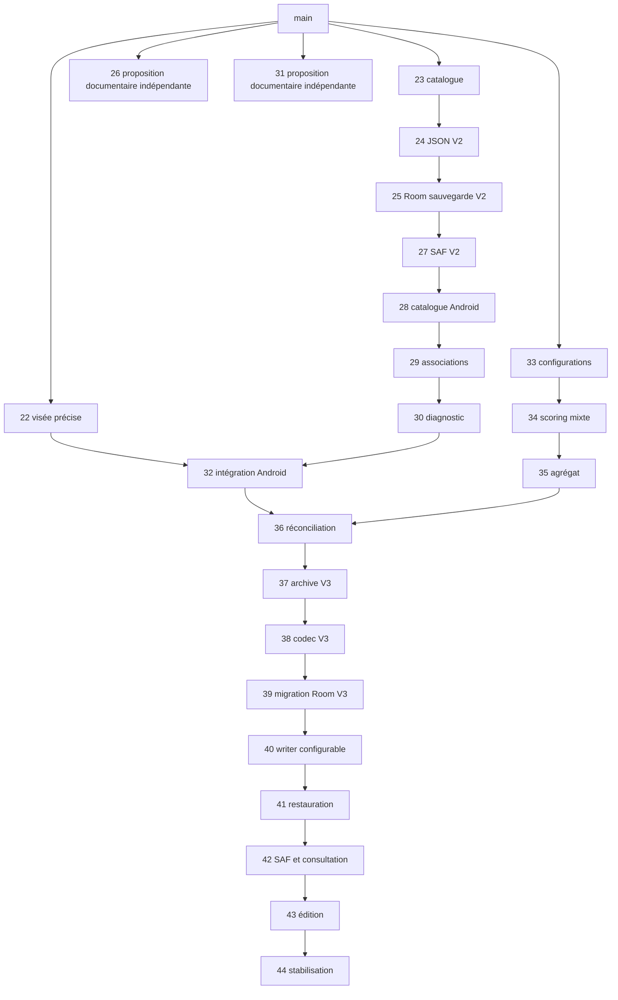

# Plan de consolidation vérifiable vers main

Audit en lecture seule du 28 octobre 2026. **Aucune fusion, fermeture de PR,
activation d'auto-merge, modification de protection ou de branche parente n'est
réalisée par la PR44.** Ce plan exige une autorisation de consolidation ultérieure.
La branche de recette part exactement de #43 `db1169869cc961853cd5a0ac8bc96233cef3a4c8`.

## État réel et preuves

`origin/main` reste `e4c7e56817baa3f5a5a366bdf5895b3d38f6b798` : les PR22–43
sont toutes ouvertes. Les têtes ci-dessous ont été contrôlées avec `gh pr view`,
`gh run list`, `git fetch`, `git merge-base --is-ancestor` et `git merge-tree`.
Aucune modification plus récente de la tête #43 n'a été trouvée au début de
la recette. Les worktrees et branches de travaux antérieurs ont été préservés.

Tous les runs liés dans ce tableau ont réussi **sur leur tête et leur ancienne
base**. Ils ne remplacent pas un run sur la future intégration à main.
Les rollups de statut anciens de #24/#25/#27/#28/#29/#30 étaient vides ; les runs
Actions ont été retrouvés par SHA exact, plutôt que de conclure à une CI absente.

| PR | Tête exacte | Base actuelle | État | Dernière preuve verte sur cette tête |
|---|---|---|---|---|
| [#22](https://github.com/LounaMaili/LMarchery/pull/22) | `c9675a257e1459daf2577220b0c0d0bcd9b3ed6e` | `main` | brouillon | [Quality gate](https://github.com/LounaMaili/LMarchery/actions/runs/38943993823) |
| [#23](https://github.com/LounaMaili/LMarchery/pull/23) | `de06429ef137c570119e57d5e9fb804ae04807df` | `main` | ouverte | [Quality gate](https://github.com/LounaMaili/LMarchery/actions/runs/38976305865) |
| [#24](https://github.com/LounaMaili/LMarchery/pull/24) | `b334c8eff5af8f4ca3872761f29d00e1d4aa97df` | `feat/equipment-catalog-foundation` | ouverte | [Quality gate](https://github.com/LounaMaili/LMarchery/actions/runs/38991483464) |
| [#25](https://github.com/LounaMaili/LMarchery/pull/25) | `ffe789f275cb73c6ffc0d81d396dccee3327d3b0` | `feat/equipment-backup-v2-contract` | ouverte | [Quality gate](https://github.com/LounaMaili/LMarchery/actions/runs/39001600076) |
| [#26](https://github.com/LounaMaili/LMarchery/pull/26) | `ae96dbda3973445ff850a77ef4e4cb3de9066b04` | `main` | brouillon | [Quality gate](https://github.com/LounaMaili/LMarchery/actions/runs/39086793997) |
| [#27](https://github.com/LounaMaili/LMarchery/pull/27) | `27054393053fbae6f41ae4270ca1dc20ab9a32f7` | `feat/equipment-backup-v2-room` | ouverte | [Quality gate](https://github.com/LounaMaili/LMarchery/actions/runs/39088332734) |
| [#28](https://github.com/LounaMaili/LMarchery/pull/28) | `cdca53515e02927a4c6f496b4178065b8258e8e7` | `feat/android-saf-backup-v2` | ouverte | [Quality gate](https://github.com/LounaMaili/LMarchery/actions/runs/39089079669) |
| [#29](https://github.com/LounaMaili/LMarchery/pull/29) | `d956dee5be74fa0246a9132bc91e818ceb0ca556` | `feat/android-equipment-catalog-ui` | ouverte | [Quality gate](https://github.com/LounaMaili/LMarchery/actions/runs/39089900425) |
| [#30](https://github.com/LounaMaili/LMarchery/pull/30) | `d7a916bf1bf21b187c2b2dba64460c0d803a53f1` | `feat/android-session-equipment-link` | ouverte | [Quality gate](https://github.com/LounaMaili/LMarchery/actions/runs/39090599039) |
| [#31](https://github.com/LounaMaili/LMarchery/pull/31) | `b2399834ecf6490d82fc433efee40fdfa6fd5379` | `main` | brouillon | [Quality gate](https://github.com/LounaMaili/LMarchery/actions/runs/39090908930) |
| [#32](https://github.com/LounaMaili/LMarchery/pull/32) | `2c3afeb81982bf9e0a0fa12d0abe3e6bbf7fa9c5` | `codex/retain-equipment-save-diagnostics` | brouillon | [Quality gate](https://github.com/LounaMaili/LMarchery/actions/runs/39493632396) |
| [#33](https://github.com/LounaMaili/LMarchery/pull/33) | `a70c05f07175664b94283cb8287b1070a941a7a1` | `main` | brouillon | [Quality gate](https://github.com/LounaMaili/LMarchery/actions/runs/39496647578) |
| [#34](https://github.com/LounaMaili/LMarchery/pull/34) | `af3598abff20bfc1960ae802cae33bf80d6f0c2b` | `codex/end-configuration-foundation` | brouillon | [Quality gate](https://github.com/LounaMaili/LMarchery/actions/runs/39500282437) |
| [#35](https://github.com/LounaMaili/LMarchery/pull/35) | `8a763e451bdd793ad78145ebc52f846a1e83bb73` | `codex/mixed-end-scoring` | brouillon | [Quality gate](https://github.com/LounaMaili/LMarchery/actions/runs/39503526480) |
| [#36](https://github.com/LounaMaili/LMarchery/pull/36) | `d9443b54f307ab8767beebe8728e17a20079041d` | `codex/integrate-precision-equipment` | brouillon | [Quality gate](https://github.com/LounaMaili/LMarchery/actions/runs/39541772143) |
| [#37](https://github.com/LounaMaili/LMarchery/pull/37) | `300389654daf659eae66cd58d2216f78da94bb82` | `codex/reconcile-android-configured-domain` | brouillon | [Quality gate](https://github.com/LounaMaili/LMarchery/actions/runs/39587451174) |
| [#38](https://github.com/LounaMaili/LMarchery/pull/38) | `e3b381027a79a6a2d56827b6ebe7f5e262d2e0ab` | `codex/configured-archive-v3-contract` | brouillon | [Quality gate](https://github.com/LounaMaili/LMarchery/actions/runs/39595413883) |
| [#39](https://github.com/LounaMaili/LMarchery/pull/39) | `d62b4fada7bf56baeeb3f3cc2dbab0ce34fba34a` | `codex/configured-archive-v3-json` | brouillon | [Quality gate](https://github.com/LounaMaili/LMarchery/actions/runs/39675748044) |
| [#40](https://github.com/LounaMaili/LMarchery/pull/40) | `17a576cc5491b5e455e71db06c87f32e7e011147` | `codex/room-v3-configured-read` | brouillon | [Quality gate](https://github.com/LounaMaili/LMarchery/actions/runs/39683138113) |
| [#41](https://github.com/LounaMaili/LMarchery/pull/41) | `c2391443de6a59b15ca3d43658458deb47725bfd` | `codex/room-v3-configured-writes` | brouillon | [Quality gate](https://github.com/LounaMaili/LMarchery/actions/runs/39722881956) |
| [#42](https://github.com/LounaMaili/LMarchery/pull/42) | `8b42c8959f04cd1c9ed5a4868a716e5b4e0c0f91` | `codex/room-v3-archive-restore` | brouillon | [Quality gate](https://github.com/LounaMaili/LMarchery/actions/runs/39880342655) |
| [#43](https://github.com/LounaMaili/LMarchery/pull/43) | `db1169869cc961853cd5a0ac8bc96233cef3a4c8` | `codex/android-saf-v3-configured-read` | brouillon | [Quality gate](https://github.com/LounaMaili/LMarchery/actions/runs/39900808720) |

La PR44 est empilée sur `codex/android-configured-session-editor`. Son propre
run est à vérifier sur le SHA publié, indépendamment de ce relevé historique.

## Ascendance et dépendances

Toutes les têtes #22–43 sont des ancêtres de #43 **sauf #26 et #31**.
Le merge `e445893` de #32 réunit #30 et #22, puis les corrections de #32.
Le merge `f2b6887` de #36 réunit #32 et #35 ; #36 ajoute aussi ses tests de
coexistence et documentation, jusqu'à `d9443b5`. #37–43 prolongent cette intégration.

Ainsi, « PR ouverte » ne signifie pas « contenu absent des descendantes ».
Après intégration de #32, #22/#23/#24/#25/#27/#28/#29/#30 seraient redondantes
**pour le code**, sous réserve d'ascendance de leurs dernières têtes. Après #36,
#33–35 le seraient également. Après #44, #37–43 le seraient. Ne pas les refusionner
pour reproduire le même contenu, ni les fermer automatiquement : contrôler leurs
éventuelles nouvelles révisions et décider avec le propriétaire de leur statut.

#26 ne contient que `docs/adr/028-seances-flexibles-edition-desktop.md` et
`docs/evolution-seances-et-desktop.md`. #31 ajoute
`docs/audit-integration-android-pr22-materiel.md`,
`docs/conception-seances-personnalisables.md` et une entrée d'index. Ces propositions
ne sont pas présentes comme fichiers dans #43, même si une partie des idées a
été implémentée. Elles restent à relire séparément : desktop, édition après
clôture et règles sportives proposées ne deviennent pas des fonctionnalités
acceptées du simple fait d'une consolidation du code.

## Simulations non destructives

Les commandes ont utilisé `git merge-tree --write-tree <gauche> <droite>` :
elles calculent des objets de simulation, sans changer index, fichiers, branches
ou historique. Les arbres calculés ne sont pas des commits publiés.

| Opérandes | Résultat observé |
|---|---|
| #22 + #30 | Conflits README, LMarcheryApp, SessionController et SessionUiState ; déjà résolus dans #32 |
| #32 + #35 | Aucun conflit textuel ; arbre `3b3bedd58852d910d9980a58199198c3c0902e2b` |
| main + #32 | Aucun conflit ; arbre égal à celui de #32 |
| #32 + #36 | Aucun conflit ; arbre égal à celui de #36 |
| #36 + #43 | Aucun conflit ; arbre égal à celui de #43 |
| #43 + #26, puis #43 + #31 séparément | Aucun conflit textuel actuel, mais revue de cohérence documentaire nécessaire |

Le résultat brut #32+#35 n'est **pas** la livraison #36 : six fichiers diffèrent
(439 insertions, 12 suppressions), notamment deux fichiers de tests de coexistence,
ADR036 et documentation. Il faut conserver #36 et ses corrections, pas remplacer
son arbre par celui d'une simulation sans conflit. L'absence de conflit textuel
ne prouve ni l'équivalence fonctionnelle ni la cohérence d'une future nouvelle base.

## Protections constatées

L'API GitHub confirme pour main : PR obligatoire, contrôle exact **Quality gate**
(app GitHub Actions 15368), branche à jour (`strict`), application aux admins,
force-push et suppression interdits. Aucune règle n'est changée.
L'historique linéaire n'est pas imposé ; le dépôt autorise les merge commits,
squash et rebase. La recommandation suivante utilise des merge commits pour
préserver l'ascendance des nombreuses PR empilées. Elle n'emploie pas `--admin`.

## Procédure recommandée, uniquement après autorisation

Trois paliers **#32 → #36 → #44 vers main**, en conservant les commits de merge,
réduisent les changements de base et réutilisent les résolutions déjà testées.
Ils n'exigent aucune nouvelle fonctionnalité ou PR de remplacement.

Pour chaque palier :

1. Relever à nouveau SHA de main, tête/base, état brouillon, protections, CI et
   travaux locaux. Si une tête a changé, réauditer son diff au lieu de la remplacer.
2. Conserver la PR existante et, après accord du propriétaire sur son périmètre
   et ses critères de recette, changer sa cible vers main. Le brouillon de #22
   et ses critères physiques ne doivent pas être contournés en fusionnant #32.
   Un report explicite des essais doit être accepté avant de rendre le palier prêt.
3. Si main n'est pas ancêtre de la tête, intégrer **main dans la branche du palier**
   par merge non destructif, sans rebase ni force-push. Même après le précédent
   palier, le nouveau commit de merge de main manque normalement à la descendante.
   Résoudre chaque conflit en conservant les garanties des deux côtés.
4. Comparer le diff et l'arbre candidat à l'union attendue des livraisons :
   conserver également tout nouveau travail légitime de main. Ne pas accepter
   une réapparition de changement déjà intégré, une perte de tests ou de traces.
5. Exécuter `./scripts/dev-check.sh --rerun-tasks --console=plain`, contrôler XML,
   douze tables, migrations, golden, liens, schémas et `git diff --check`.
   La recette #44 doit être exécutée sur le dernier palier ; les suites alors
   disponibles restent obligatoires aux paliers précédents.
6. Publier sans force-push et attendre **un nouveau Quality gate** correspondant
   à la tête finale et à la nouvelle base. Le workflow actuel écoute
   `opened/synchronize/reopened` par défaut ; changer seulement la base ne
   garantit pas un nouveau run. Le merge nécessaire de main produit un nouveau
   commit et l'événement `synchronize`. Si aucun commit n'est nécessaire, lancer
   explicitement `workflow_dispatch` sur la tête et consigner le SHA de main et
   l'équivalence de l'arbre candidat. Vérifier que le contrôle requis est réellement
   satisfait ; s'il manque, arrêter plutôt que réutiliser une ancienne preuve.
7. Seulement après toutes les validations et l'autorisation de fusion : merge
   commit via GitHub, sans contournement de protection, puis vérifier le SHA et
   le **nouveau run push sur main**. Synchroniser le checkout local de main par
   fast-forward uniquement, relancer la validation et vérifier l'arbre propre.
8. Avant le palier suivant, recalculer l'ascendance et les différences. Fermer
   d'anciennes PR redondantes exige une décision distincte, documentant les SHA
   désormais contenus ; ne pas considérer leur état GitHub comme preuve Git.

Le premier palier apporte la combinaison visée/matériel/SAF V2. Le deuxième
apporte le domaine configurable et les tests de coexistence sans écritures
mixtes. Le dernier apporte archive V3, migration Room V3, writer, restauration,
SAF V3, éditeur et stabilisation. Toute fusion partielle doit laisser un dépôt
compilable et vérifier son propre run sur main.

Si le propriétaire préfère une série de squash merges, chaque descendante doit
être réconciliée avec le nouveau main sans réécriture distante et entièrement
revérifiée. Cette option multiplie les risques de changements déjà appliqués
réapparaissant dans les diffs ; elle n'est pas le choix recommandé pour cette pile.

## Conditions d'arrêt et risques résiduels

- Arrêter en cas de modification distante inattendue, conflit non résolu, test
  échoué/ignoré, check absent ou protection non satisfaite. Ne supprimer aucun
  travail local et ne jamais choisir mécaniquement « ours/theirs ».
- Ne pas confondre les tests JVM de contrôleurs avec une recette Compose/tactile,
  processus Android ou fournisseur SAF réel. La [recette PR44](recette-integration-v3-pr44.md)
  distingue ces preuves et les essais physiques reportés.
- Aucune installation intermédiaire n'est prévue par la consolidation Git. Un
  fichier migré Room V3 ne doit pas être rouvert par un APK Room V1/V2. La future
  validation physique doit utiliser une installation isolée, puis un protocole
  de sauvegarde/migration approuvé pour l'application réelle.
- Restent des arbitrages produit, sans implémentation ici : obligation éventuelle
  de compléter FIXED, comparabilité sportive de configurations mixtes, correction
  rétroactive et réouverture après clôture, profils personnalisés dans les formulaires.

Priorités après #44 : revue et autorisation du plan, recette physique isolée
lorsqu'elle sera possible, puis consolidation progressive avec nouveaux runs.
Aucune #45, migration, révision JSON ou fonctionnalité indépendante n'est lancée.
