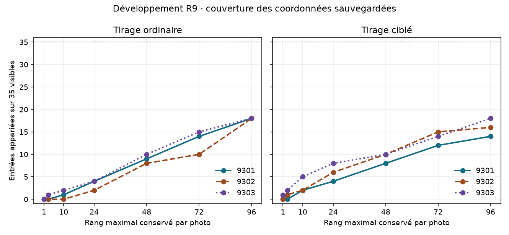

# R10 · Où se perdent les contacts dans les listes de R9 ?

**NO-GO Android maintenu.** Sur les 35 contacts visibles du développement, un classement parfait des 96 coordonnées archivées par photo pourrait en retrouver **14 à 18 selon l’essai**. Dix contacts distincts restent hors tolérance dans les six essais. Au seuil de décision R9, les six essais gardent leur rappel observé de **0/35**. La prochaine expérience proposée vérifie si la troncature au rang 96 explique une partie des absences. Elle reste à exécuter.

[Protocole du diagnostic](r10/protocole.md) · [Tableaux des 72 listes et relevés individuels](r10/tableaux.md) · [Bilan numérique](r10/bilan.json) · [Mesures par provenance](r10/mesures.json) · [Planches et courbe de couverture](r10/planches/README.md) · [Protocole de l’expérience proposée](r10/experience-suivante.md)

## Données et lecture exécutée

Douze photos de développement R9, douze provenances, treize supports, trente-cinq entrées visibles, cinq entrées incertaines et trois témoins vides. Les références sont les lectures assistées de R9. Les six checkpoints fournissent chacun une liste de 96 coordonnées et scores par photo au pas 96. R10 a relu les 6 912 propositions archivées. L’appariement sur les coordonnées enregistrées reproduit les appariements et les décomptes de faux et de non-résolus de R9 à 0,50. La règle de lecture a été publiée avant le diagnostic. [Commit de gel](https://github.com/LounaMaili/LMarchery/commit/dc0886ed3c869f0514e1d8a99f6831eb94051a70) · [Sources des photos](r9/sources.json) · [Entrées et empreintes](r10/entrees.json) · [Reproduction](r10/reproduire.md)

Pour chacune des 72 listes, le premier contact appariable est le premier pic à moins de 10 px ou exactement 10 px d’une entrée visible dans le repère R6. Tous les scores plus élevés et les trois premières positions ont été examinés sur la photo et sur des agrandissements. Quand la liste ne présente aucun contact appariable, les 96 points font partie de la lecture. Cette règle donne **4 822 observations visuelles**, dont 4 814 précèdent le premier contact ou appartiennent à une liste sans contact. Après mutualisation des coordonnées strictement identiques sur une même photo, **2 660 positions** ont été lues. Les tableaux numériques conservent aussi les points plus bas dans le classement. Les planches de détail montrent les pixels de 2 390 positions. Pour les 270 autres, le recadrage se trouve hors de la zone retenue pour publier les scènes avec des personnes. Leur rang, leur score et leur lecture restent consultables. [Loupes indexées par position](r10/planches/loupes/README.md)

## Classement et couverture

| Essai | Listes avec au moins un contact appariable / 12 | Points avant le premier¹ | Dont non résolus | Contacts retrouvables au rang 3 / 35 | Contacts retrouvables au rang 96 / 35 | Contacts sans aucun candidat / 35 |
|---|---:|---:|---:|---:|---:|---:|
| Ordinaire 9301 | 6 | 794 | 82 | 0 | 18 | 17 |
| Ordinaire 9302 | 6 | 855 | 61 | 0 | 18 | 17 |
| Ordinaire 9303 | 5 | 783 | 40 | 1 | 18 | 17 |
| Ciblé 9301 | 5 | 778 | 104 | 0 | 14 | 21 |
| Ciblé 9302 | 4 | 831 | 100 | 1 | 16 | 19 |
| Ciblé 9303 | 5 | 773 | 61 | 2 | 18 | 17 |

¹ Somme de rangs **locaux à chaque photo**, avec la convention de liste entière indiquée plus haut. R9 avait mesuré une autre quantité pour la décision opérationnelle, le coût du premier contact en classant les scores sur tout le lot. Ce coût allait de 41 à 234 non-appariées pour trois autorisées. [Frontières de décision R9](r9/selection.json)

Sur les 48 listes provenant d’une photo avec au moins une entrée visible, 31 contiennent une proposition appariable et 17 en sont dépourvues. Les 24 listes restantes concernent un témoin vide ou une photo sans entrée visible de référence. À 0,50, les trois témoins vides déclenchent pour chaque essai. Au seuil 2,0 retenu dans R9, les 12 photos sont silencieuses dans chaque essai, avec zéro faux établi et zéro cas non résolu émis. [Mesures par provenance et par seuil](r10/mesures.json)

La courbe utilise l’appariement un à un pour chacun des sept préfixes. Une association peut changer quand de nouveaux candidats entrent dans la liste. [Données numériques de la courbe](r10/planches/couverture.json)

## Lecture des erreurs et statut de référence

| Aspect au centre du pic | Parmi les trois premières positions (216) | Avant le premier appariable ou dans une liste sans contact (4 814) |
|---|---:|---:|
| Fond, texture du support ou autre élément de la scène | 83 | 2 282 |
| Motif, zone colorée du blason, lettrage ou autre marquage | 23 | 872 |
| Trou ou déchirure visible | 39 | 662 |
| Ombre identifiable | 0 | 4 |
| Corps de tube | 20 | 165 |
| Extrémité opposée à l’entrée, dont empennage | 24 | 159 |
| Élément visuellement indéterminé | 27 | 670 |

Les 4 814 observations comprennent **4 366 faux établis et 448 cas non résolus** selon les références R9. Une photo partiellement inventoriée ou une zone ignorée peut comporter un pic sur un objet visuellement reconnaissable dont le statut de contact reste non résolu. À l’inverse, le fond d’un témoin exhaustif peut fournir un faux établi dont le détail physique reste illisible. La catégorie visuelle et le statut de référence occupent deux colonnes indépendantes dans chaque relevé. Les six essais réutilisent les mêmes douze photos. Les répétitions de pics décrivent les sorties des modèles et ne constituent pas de nouvelles acquisitions.

### Observations par provenance

| Provenance | Observation sur les pixels et les références |
|---|---|
| April L. Sanders | La plupart des pics examinés tombent sur la paille ou le décor. L’entrée du tube est occultée, sans coordonnée de référence. |
| cobaltfish | Des pics précoces se placent sur les fûts et empennages. Le premier appariable va du rang 1 au rang 13. Le relevé incomplet laisse des non-appariées non résolues. |
| Framsókn | Les premiers points incluent des extrémités colorées, des tubes et des éléments de scène. Le premier appariable arrive aux rangs 23 à 40. Une des sept entrées visibles reste sans voisin dans les six essais. |
| gothick_matt | L’empennage, la paille et les bords du support reçoivent des pics. Aucune des 576 propositions n’est appariable à l’unique entrée visible. |
| Iain Cuthbertson | Sur ce témoin vide, des pics couvrent notamment la grille, le bâti et le bord du blason. La nature de plusieurs traits noirs flous reste indéterminée. |
| Ivan Radic | Seize des dix-huit premiers points (trois par essai) se placent sur des perforations. Quatre sorties reprennent le même pixel sur l’ombre portée du fût. Aucun essai ne couvre l’entrée visible. Le second support, incertain, reste ignoré pour la vérité de contact. |
| russellstreet | Sur le témoin vide, les pics se répartissent entre arrière-plan, chevalet et anneaux. Un pic du bras ordinaire 9301 atteint 0,8016 au rang 1 sur le support. |
| Staff Sgt. Brent Powell | Les points précèdent souvent le contact sur des éléments de scène, le corps de flèche ou l’empennage. Le premier appariable est au rang 77 en ordinaire 9301. Deux essais ciblés n’ont aucun voisin d’un contact. La photo est incomplètement inventoriée. |
| TheNickster | Un croisement de fûts atteint 0,7464 au rang 1 du ciblé 9303. En ordinaire 9302, le premier contact appariable arrive au rang 83. |
| TimWilson | Sur ce témoin vide, les 18 premières positions touchent des perforations. Le relevé contient aussi des pics sur le lettrage et les motifs du support. |
| vastateparksstaff | Plusieurs rangs 1 se situent sur les anneaux de la toile tissée. Une seule des cinq entrées visibles acquiert un voisin dans au moins une des six listes. |
| Wesley Fryer | Le haut du classement contient des empennages et des fûts. L’ordinaire 9301 conserve deux pics non appariés supplémentaires à portée de l’entrée nº 5. Trois des six entrées visibles restent sans voisin dans tous les essais. |

Les [tableaux](r10/tableaux.md) relient ces observations aux bras, graines, rangs, scores et statuts. Les [douze planches](r10/planches/README.md) illustrent des cas individuels. Par exemple, sur Wesley Fryer, le candidat redondant du ciblé 9301 au rang 26 a un score de 0,5361. Une proposition plus basse est plus proche de la même entrée. Au total, vingt couples *entrée × essai* ont plusieurs voisins admissibles, sept pics admissibles restent sans appariement final et quinze pics sont admissibles à deux entrées ou plus. Ces compteurs portent sur des situations qui peuvent se recouvrir.

## Portée et décision

**Établi sur ce développement.** Les coordonnées disponibles et l’ordre des scores limitent tous deux le rappel. Les dix entrées sans voisin dans les six listes proviennent de cinq acquisitions. Un reclassement de ces seules coordonnées ne pourrait atteindre le critère R6 de 70 % sur ces 35 références pour aucun des six checkpoints. Les exemples visuels établissent ce qui se trouve sous les pics examinés. Leur cause interne et leur fréquence sur d’autres supports restent inconnues. Il s’agit d’une lecture assistée du développement, sans adjudication indépendante supplémentaire.

**Hypothèse.** Certaines entrées manquantes pourraient correspondre à des maxima de la carte de contact éliminés par la limite de 96. Les archives s’arrêtent précisément à cette limite sur les 72 listes. Elles ne permettent pas de vérifier cette explication.

**Une expérience proposée.** Comparer les préfixes 96 et 192 sur les mêmes cartes des six checkpoints figés. Budget maximal de 72 passages sur photo entière et zéro entraînement. Le protocole fixe le gain requis, la diversité des provenances, la règle d’arrêt et les mesures secondaires. [Protocole publié avant comparaison](r10/experience-suivante.md)

R10 a utilisé uniquement les prédictions et images de développement. L’incident d’exposition antérieure a une trace locale à accès restreint. La qualification de l’acquisition concernée reste à décider avant l’ouverture du test, après vérification de l’indépendance de la lecture et de tout usage dans les réglages. Le test reste fermé. L’adjudication R8, le NO-GO Android et le périmètre du laboratoire sont conservés.
