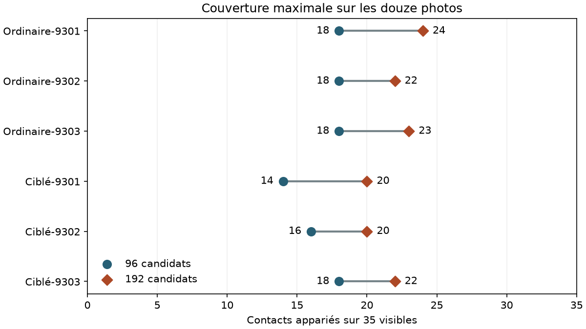

# R11 · Le plafond de 96 candidats limite la couverture sur le développement

**Les deux critères préenregistrés sont atteints.** Passer de 96 à 192 candidats par photo permet d’apparier **quatre à six contacts supplémentaires sur 35 pour chacun des six checkpoints**, avec un gain sur deux à cinq provenances selon l’essai. Trois des dix contacts jusque-là sans candidat acquièrent un voisin, sur trois provenances distinctes. **Au budget opérationnel, le rappel reste de 0/35.** Le NO-GO Android est maintenu.

[Protocole R10](https://github.com/LounaMaili/LMarchery/blob/edd8e28505a84ec42d98f42cf4334576b931714e/vision-lab/r10/experience-suivante.md) · [Précisions publiées avant exécution](https://github.com/LounaMaili/LMarchery/blob/c8c086cc7114ff857b2af7da7f2df7372e76bd44/vision-lab/r11/protocole.md) · [Décision numérique](r11/mesures/decision.json) · [Tableaux par checkpoint et provenance](r11/tableaux.md) · [Figures et valeurs numériques](r11/figures/README.md)

## Comparaison exécutée et parité

Le développement R9 contient douze photos de douze provenances, treize supports, 35 contacts visibles, cinq entrées incertaines et trois témoins vides. Les deux bras et les trois graines désignent les six checkpoints R9 figés au pas 96. Une seule exécution CPU séquentielle a calculé une carte fusionnée à deux canaux pour chaque couple checkpoint/photo, soit **72 passages**. Chaque carte a fourni une liste triée dans l’ordre R7. Les deux préfixes proviennent de cette même liste. Les images orientées, la résolution, les tuiles, la fusion, le plancher de score, les maxima et les ex æquo reproduisent le traitement R9. Les six poids et les douze images ont été vérifiés par empreinte avant le premier passage. [Sources, crédits et licences](r9/sources.json) · [Inventaire des entrées locales](r11/inventaire.json)

**Parité exacte sur les 72 listes courtes.** Les 6 912 coordonnées et scores sont identiques en valeur et en ordre. Après sérialisation, les six fichiers de prédictions au préfixe 96 reproduisent octet pour octet les archives de développement R9. La couverture à 96 reproduit R10 pour chaque couple checkpoint/photo. Le coût global du premier contact et les résultats aux deux seuils historiques reproduisent également R9. [Preuves de parité par essai et photo](r11/parite.json) · [Commandes de reproduction](r11/reproduire.md)

## Résultats par checkpoint

Chaque photo a fourni effectivement **96 puis 192 candidats**, dans les 72 comparaisons. Cela représente 1 152 puis 2 304 candidats par checkpoint. La couverture maximale compte les entrées visibles appariées un à un dans un rayon de 10 px au repère R6, en conservant toute la liste. Le coût du premier contact compte les propositions non appariées sur le lot entier au meilleur score admettant un vrai contact, avec tous ses ex æquo.

| Checkpoint | Couverture à 96 | Couverture à 192 | Gain | Provenances en gain | Coût du premier contact, à 96 et à 192 |
|---|---:|---:|---:|---:|---:|
| Ordinaire 9301 | 18/35 | 24/35 | +6 | 5 | 234 |
| Ordinaire 9302 | 18/35 | 22/35 | +4 | 3 | 166 |
| Ordinaire 9303 | 18/35 | 23/35 | +5 | 4 | 41 |
| Ciblé 9301 | 14/35 | 20/35 | +6 | 3 | 87 |
| Ciblé 9302 | 16/35 | 20/35 | +4 | 4 | 134 |
| Ciblé 9303 | 18/35 | 22/35 | +4 | 2 | 91 |

Le premier critère demandait quatre checkpoints atteignant chacun +4 sur au moins deux provenances. Les **six** le satisfont. Les groupes serrés passent de 9–13 à 13–16 appariements sur 21 selon le checkpoint. Les supports usés passent de 8–11 à 11–14 sur 24. Ces strates se recouvrent. Les six checkpoints partagent les mêmes douze photos. [Gains par provenance](r11/figures/provenances.png) · [Mesures des strates, des faux établis, des non résolus et des témoins vides](r11/tableaux.md)

## Devenir des dix contacts absents

Le second critère demandait qu’au moins deux des dix entrées prédéfinies acquièrent un candidat sur deux provenances distinctes. **Trois entrées sur trois provenances** ont un voisin dans la tolérance et obtiennent effectivement un appariement. Les rangs ci-dessous sont locaux à la photo et au checkpoint.

| Entrée | Checkpoints qui la retrouvent | Rang et score du meilleur voisin |
|---|---|---|
| Framsókn nº 4 | Ordinaire 9301, ordinaire 9302, ciblé 9303 | 142 (0,2954), 154 (0,2699), 190 (0,3308) |
| vastateparksstaff nº 5 | Ordinaire 9301 | 186 (0,5350) |
| Wesley Fryer nº 3 | Ordinaire 9303 | 101 (0,4819) |

Les sept autres restent sans voisin dans les six listes étendues. Ce sont gothick_matt nº 1, Ivan Radic nº 1, vastateparksstaff nº 1, 3 et 4, et Wesley Fryer nº 1 et 6. Les gains par checkpoint incluent aussi des entrées qu’un autre checkpoint couvrait déjà à 96. [Devenir des dix entrées, scores exacts](r11/mesures/dix-entrees.json) · [Liste de toutes les entrées nouvellement admissibles par essai](r11/tableaux.md)

## Portée opérationnelle et décision

À 0,50, deux checkpoints gagnent un contact chacun, l’ordinaire 9301 et le ciblé 9302. Les quatre autres conservent le même rappel. Les trois témoins vides déclenchent à ce seuil dans chaque essai pour les deux préfixes. Au seuil de décision R9 de 2,0, les douze photos sont silencieuses dans les douze configurations, avec zéro faux établi, zéro non résolu émis et zéro déclenchement sur témoin vide.

**À scores inchangés, l’extension ne peut pas améliorer le rappel au budget actuel avec la même sélection par seuil.** Pour qu’un point de rang 97 ou plus passe le seuil, au moins 97 propositions d’une seule photo passent aussi, ex æquo inclus. Même en leur accordant les 35 contacts visibles du lot entier, il resterait au moins 62 non-appariées, pour un budget de trois sur douze photos. Les ensembles de propositions admissibles au budget sont donc identiques. La sélection rejouée aux scores observés retrouve bien 2,0 pour les six checkpoints et chacun des deux préfixes.

Le gain établit que la troncature à 96 écarte des candidats utiles sur ce développement. Sa portée est **diagnostique**. Le meilleur plafond observé à 192 est de 24/35 (68,6 %) avant toute contrainte sur les fausses propositions. Les sept absences à 192 ne démontrent pas l’absence de signal dans les cartes. La comparaison observe uniquement les maxima admis par le décodeur puis conservés dans ces deux préfixes. Les références sont assistées, le développement a déjà servi à formuler la question, et le test réservé reste fermé.

**Recommandation.** Conserver les listes à 192 comme référence diagnostique pour une future étude du classement. Donner la priorité au coût du premier contact sur des provenances indépendantes avant d’envisager une adoption produit. Ce coût reste de 41 à 234 propositions non appariées pour trois autorisées. R11 s’arrête à ce bilan. Aucun autre plafond, entraînement ou essai externe n’a été lancé. Les contrats photo et calibration partagés avec Desktop D3 sont préservés.
