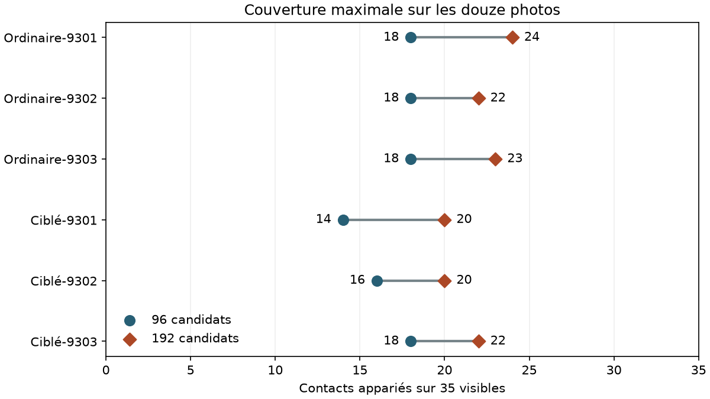
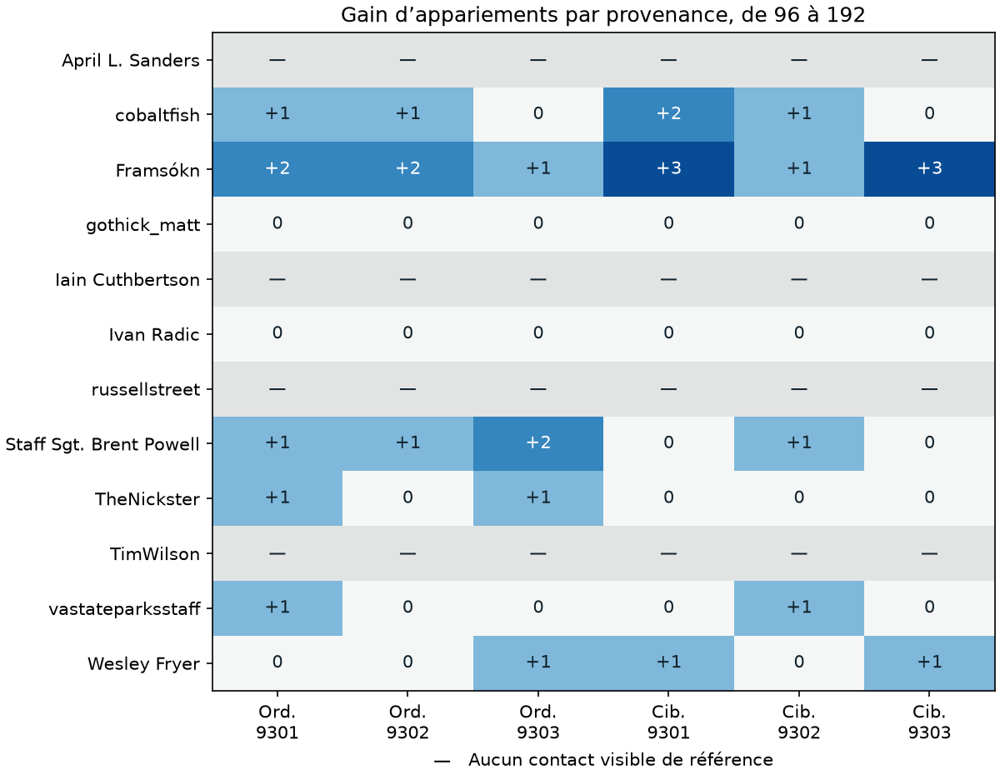

# Figures de couverture R11

Chaque ligne correspond à un checkpoint figé. Le cercle et le losange donnent la cardinalité de l’appariement un à un sur les 35 entrées visibles, à 96 puis 192 candidats par photo.

Un tiret indique une provenance sans entrée visible de référence. Un zéro indique une photo avec des contacts visibles où le nombre d’appariements reste identique. Les douze provenances comptent chacune une photo.

[Valeurs numériques des deux figures](valeurs.json) · [Tableaux et données sources](../tableaux.md) · [Script de tracé](../publier.py) · [Reproduction](../reproduire.md)
