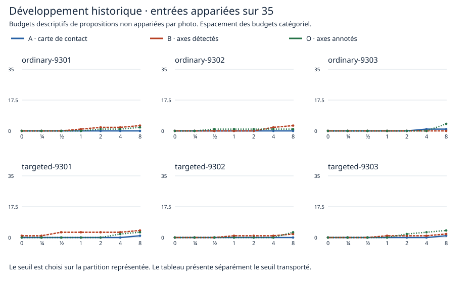
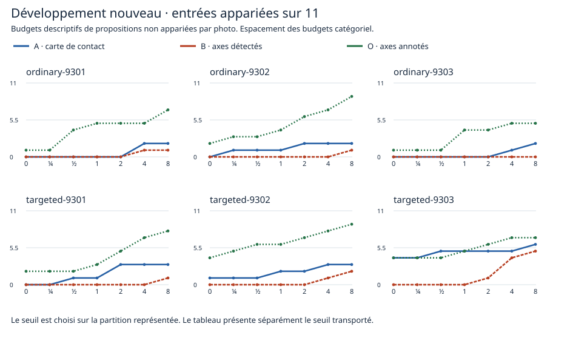

# Courbes R12

Chaque panneau représente un checkpoint. A utilise la carte de contact, B les tubes détectés et O les traits annotés de référence. L’ordonnée compte les contacts retrouvés sur 35 ou sur 11. Les budgets en abscisse sont des catégories également espacées. Les points reliés représentent des mesures discrètes. Pour chaque budget, prendre la dernière coupure réalisable sur les scores observés sans dépasser le budget, avec tous les ex æquo. Le nombre maximal d’appariements est monotone quand le seuil descend. Les compteurs peuvent inclure des faux supplémentaires à même rappel à cette dernière coupure. La [sélection opérationnelle](../tableaux.md) préfère le moins de non-appariées à rappel égal et transporte le seuil depuis le développement historique. Le point à ¼ sur la seconde figure est donc une enveloppe descriptive locale.

Les fichiers JSON Lines donnent la coupure exacte, les neuf compteurs sur photo entière, et leur ventilation par provenance, sur les supports usés et sur les groupes. Une ligne représente un budget, une méthode et une partition.

[Ordinaire 9301](ordinary-9301.jsonl) · [Ordinaire 9302](ordinary-9302.jsonl) · [Ordinaire 9303](ordinary-9303.jsonl) · [Ciblé 9301](targeted-9301.jsonl) · [Ciblé 9302](targeted-9302.jsonl) · [Ciblé 9303](targeted-9303.jsonl) · [Code de reproduction](../publier.py)
