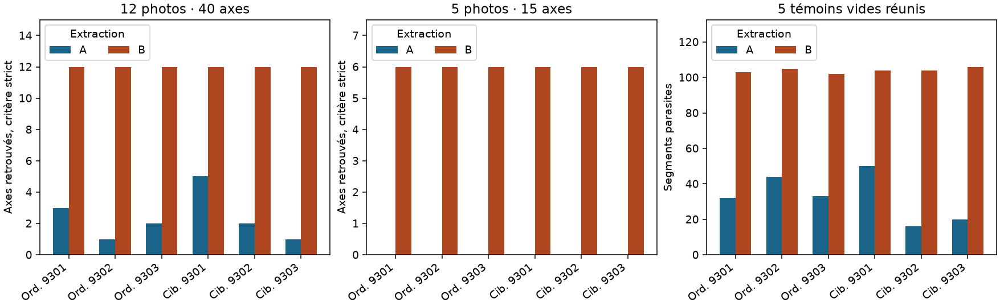
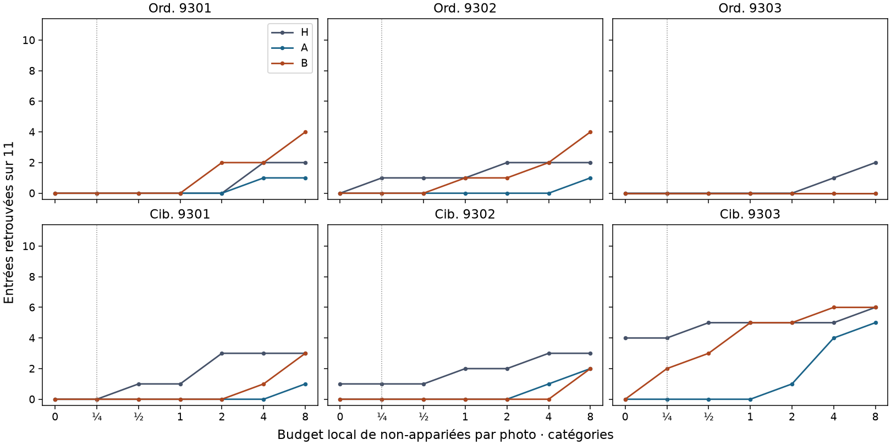
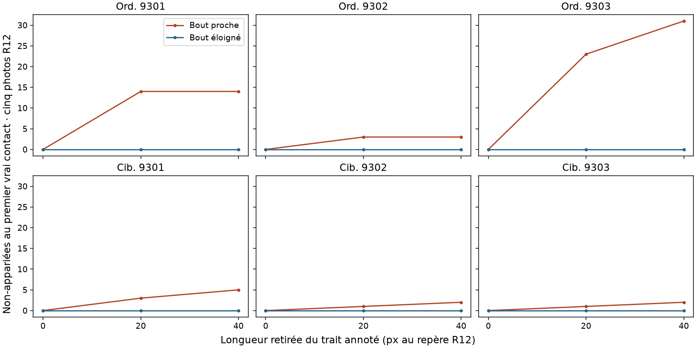

# Figures et données R13

A est la PCA historique. B reconstruit des axes à partir des segments LSD. Le critère strict exige un segment unique couvrant au moins 11 des 21 sondes de la référence, à 6 px et 20° près.

H emploie le score brut. Les points sont les enveloppes locales aux budgets indiqués. Les abscisses sont catégorielles et les traits relient les mesures discrètes. Les seuils effectivement transportés et leur budget réalisé se trouvent dans les [tableaux](../tableaux.md).

Les six fichiers JSON donnent les valeurs des trois figures et les compteurs des courbes par provenance, groupes et usure. Pour chaque budget, la courbe prend la dernière coupure admissible parmi les scores observés, avec ex æquo. Le choix opérationnel favorise le moins de non-appariées à rappel égal. [Ordinaire 9301](ordinary-9301.json) · [Ordinaire 9302](ordinary-9302.json) · [Ordinaire 9303](ordinary-9303.json) · [Ciblé 9301](targeted-9301.json) · [Ciblé 9302](targeted-9302.json) · [Ciblé 9303](targeted-9303.json)
