# Planches de diagnostic

Ordinaire 9301, toutes les photos des deux partitions. Fond sombre = sous le seuil tube 0,5, gris clair = masque. Turquoise = tracés humains, cercle jaune = entrée visible, rose = axes extraits. Un trait humain sans cercle a une entrée de position inconnue. Les extrémités sont celles des segments affichés. Les trois vues ont le même repère.

## Wesley Fryer

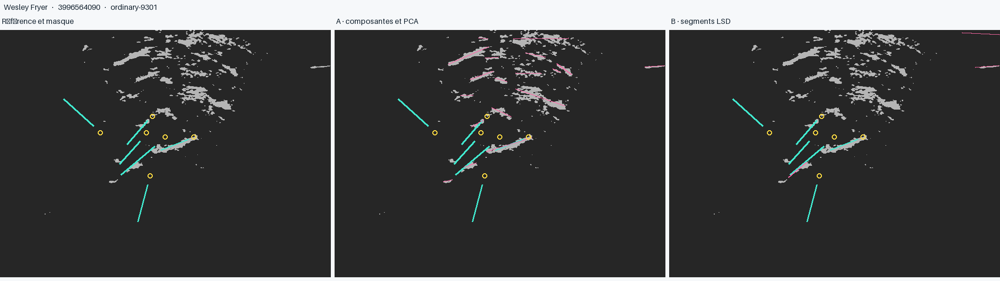

## Staff Sgt. Brent Powell

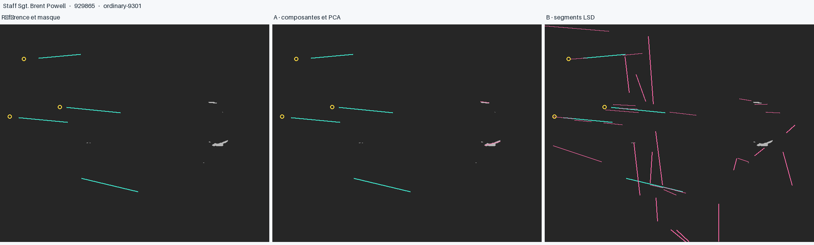

## russellstreet

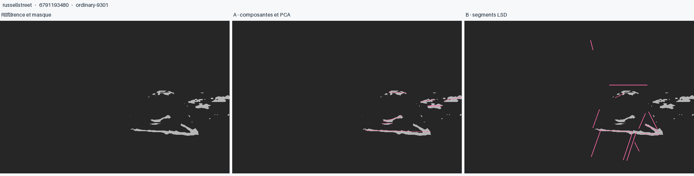

## Ivan Radic

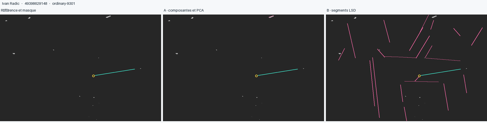

## gothick_matt

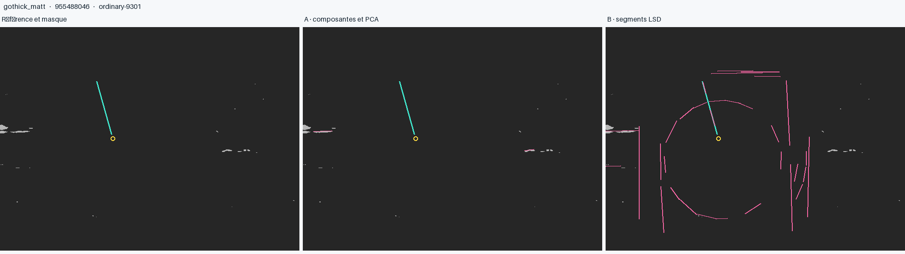

## April L. Sanders

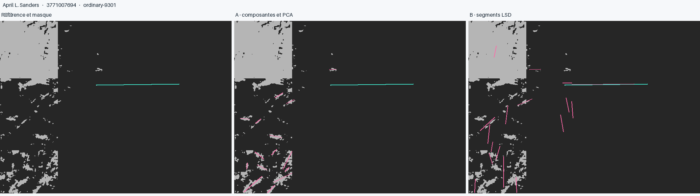

## TheNickster

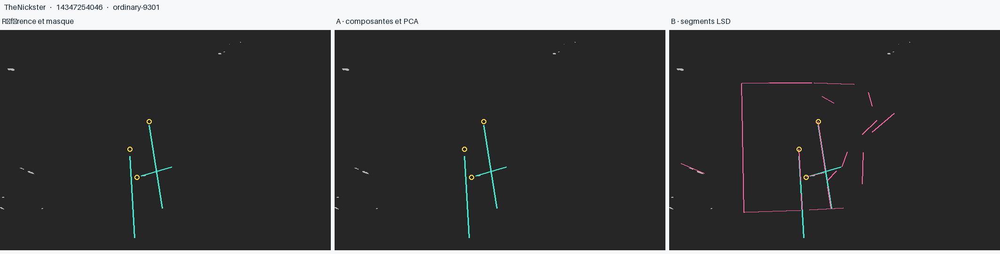

## TimWilson

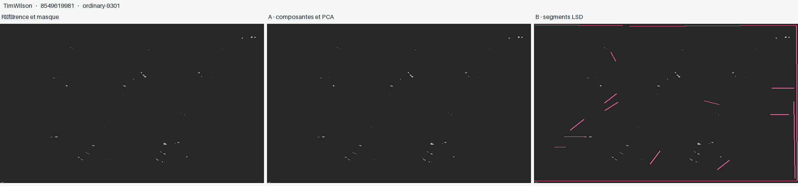

## vastateparksstaff

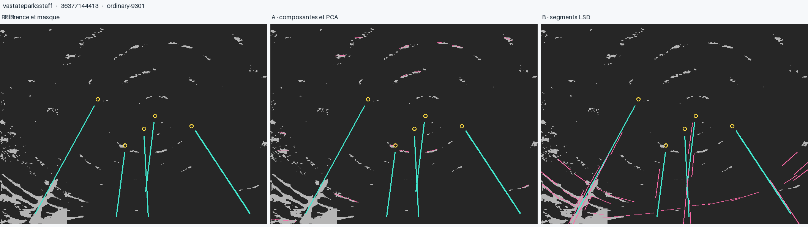

## cobaltfish

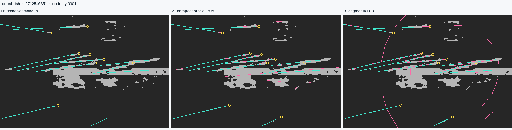

## Framsókn

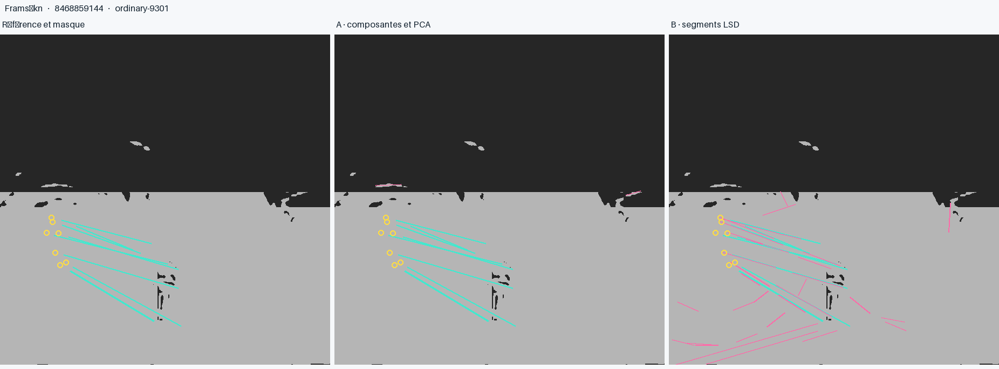

## Iain Cuthbertson

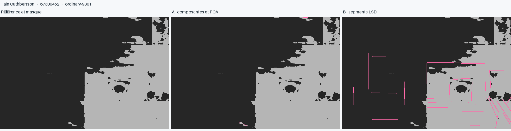

## Tomi Backman

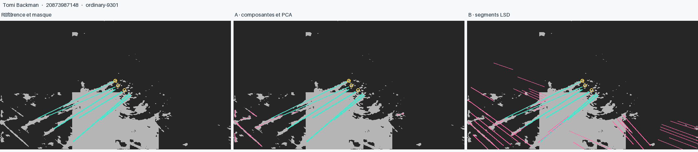

## maggiewilson177

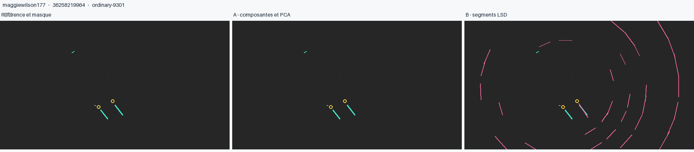

## ttillma8

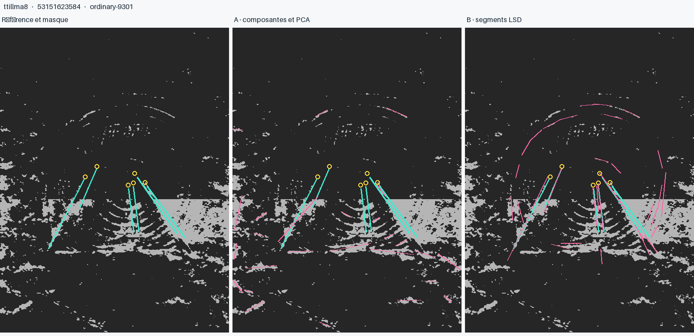

## chb1848

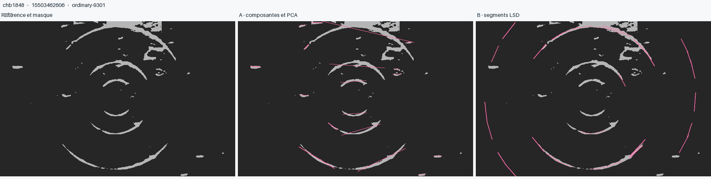

## mikecogh

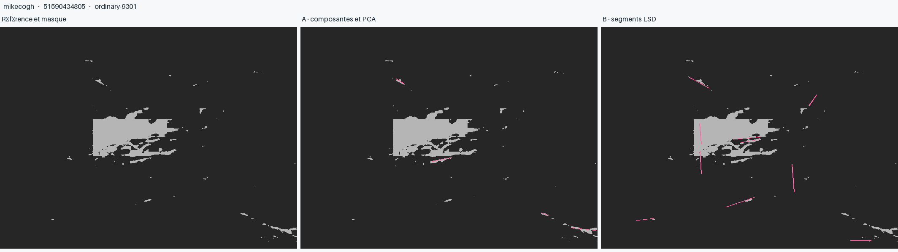
