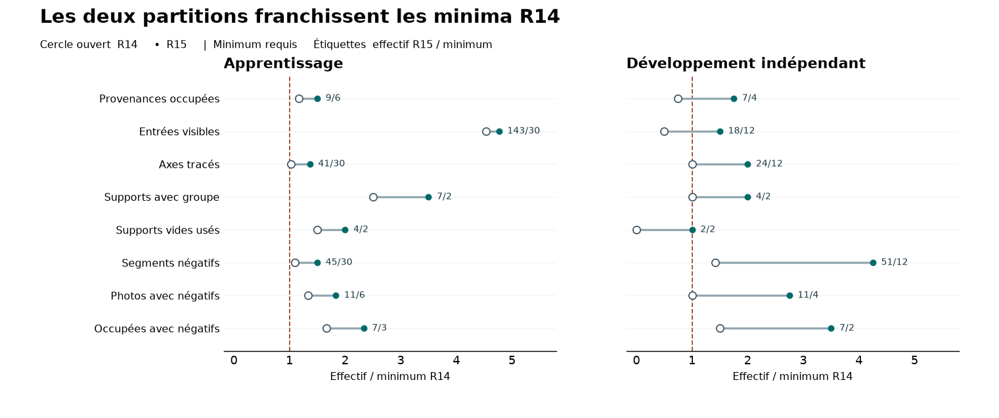
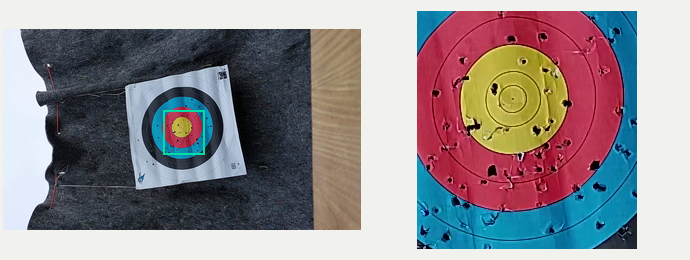
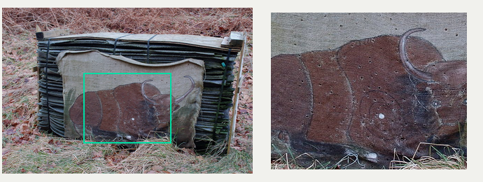
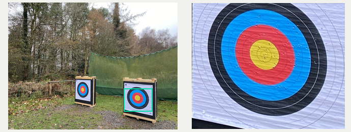

# Portes et témoins vides

Chaque rangée utilise son propre minimum R14. Les effectifs bruts, le minimum et la partition sont publiés pour les seize rangées. [Valeurs tracées](valeurs.json) · [Générateur](../figurer.py)

## Trois supports vides usés nouvellement admis

La vue de gauche permet de contrôler l’absence de tube sur le support. Le rectangle indique l’emplacement de l’agrandissement de droite. Les planches sont réduites et recadrées pour cette revue. Chaque planche conserve l’attribution et la licence de sa source. [Coordonnées des cadres dans les sources orientées](cadres.json)

**Développement · arrowcounting.** Le papier fixé au tapis sombre porte des perforations jusque dans le jaune. La deuxième image publique étiquetée `0_empty` appartient au même groupe de provenance. Image du compte arrowcounting, CC BY 4.0. [Fiche du projet](https://universe.roboflow.com/arrowcounting/arrow_counting) · [JPEG source](https://source.roboflow.com/uOu7h19RbPP9mwujrTEFnvCzQCJ3/0pHGx6yITFtGgR4Uen1L/original.jpg) · [Licence](https://creativecommons.org/licenses/by/4.0/)

**Développement · Jim Barton.** À Hogg Park, les perforations sont visibles sur la silhouette imprimée et dans la toile au-dessus du dos. Le bord effiloché seul aurait constitué un indice insuffisant. Photographie « Archery target, Hogg Park », Jim Barton, Geograph, CC BY-SA 2.0. [Fiche de l’image](https://commons.wikimedia.org/wiki/File:Archery_target,_Hogg_Park_-_geograph.org.uk_-_2248040.jpg) · [Licence](https://creativecommons.org/licenses/by-sa/2.0/)

**Apprentissage · Alan Hughes.** Deux chevalets et leurs feuilles apparaissent dans la même acquisition. Les trous et lèvres sur le jaune, le rouge et le bleu de la feuille de droite établissent l’usure. Photographie « Archery targets », Alan Hughes, Geograph, CC BY-SA 2.0. [Fiche de l’image](https://commons.wikimedia.org/wiki/File:Archery_targets_-_geograph.org.uk_-_7043212.jpg) · [Licence](https://creativecommons.org/licenses/by-sa/2.0/)

