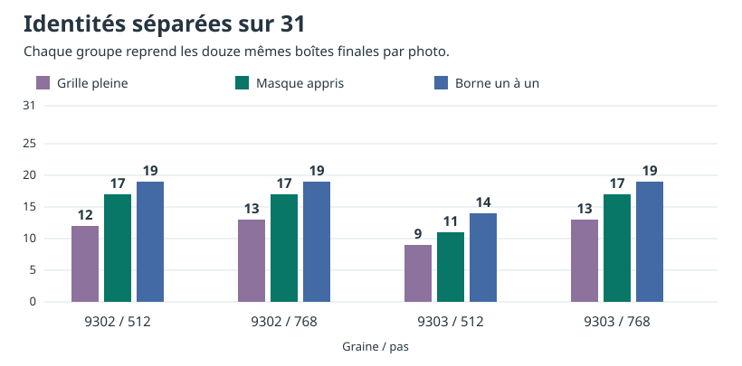

# Figures et données R28

[Comparaison des appariements et de la borne](separations.svg) · [Toutes les données des figures](donnees.json) · [Mesures par photo et par q](../mesures/README.md)

## Calques des neuf photos du train

Chaque ligne de planche représente un contrôle. La première colonne montre les étiquettes R18. Les deux suivantes superposent les masques appris séparés, puis les supports pleins des mêmes q. Les couleurs mauve clair et violet foncé identifient respectivement une zone inconnue hors prédiction et une zone inconnue couverte. Le fond certifié couvert apparaît en rouge, l’identité correspondante en vert foncé et une autre identité connue couverte en orange. En cas de superposition de sorties, une couverture par sa propre sortie est prioritaire.

| Photo | Provenance | Planche |
| --- | --- | --- |
| 13-01 | Crigges | [Quatre contrôles](photo-13-01.png) |
| 70-01 | Crigges | [Quatre contrôles](photo-70-01.png) |
| 7245527662 | jrladia | [Quatre contrôles](photo-7245527662.png) |
| 5115614018 | Danielle Walquist Lynch | [Quatre contrôles](photo-5115614018.png) |
| 18105652008 | zigazou76 | [Quatre contrôles](photo-18105652008.png) |
| 24614689941 | renatomitra | [Quatre contrôles](photo-24614689941.png) |
| 4169106197 | cristina.sanvito | [Quatre contrôles](photo-4169106197.png) |
| wc71488242 | Bernard Gagnon | [Quatre contrôles](photo-wc71488242.png) |
| wc11001401 | 4028mdk09 | [Quatre contrôles](photo-wc11001401.png) |

## Les douze transitions

Les deux lignes reprennent 512 et 768 dans la même fenêtre native. Les panneaux comparent la référence de l’identité, le masque de meilleur Dice et le remplissage du même q, y compris lorsque q échoue au seuil. La fenêtre englobe la boîte de référence et les meilleures boîtes selon Dice et IoU aux deux pas, avec une marge de 6 % du plus grand côté (8 pixels minimum), bornée à la photo. Les cartes sont affichées au plus proche voisin. Les mesures et les empreintes de pixels portent sur la résolution native.

| Graine | Identité | Provenance | Sens | Planche |
| --- | --- | --- | --- | --- |
| 9302 | 5115614018:2 | Danielle Walquist Lynch | gain | [Deux pas](transition-9302-5115614018-2.png) |
| 9302 | 5115614018:4 | Danielle Walquist Lynch | gain | [Deux pas](transition-9302-5115614018-4.png) |
| 9302 | wc71488242:3 | Bernard Gagnon | perte | [Deux pas](transition-9302-wc71488242-3.png) |
| 9302 | wc11001401:2 | 4028mdk09 | gain | [Deux pas](transition-9302-wc11001401-2.png) |
| 9302 | wc11001401:3 | 4028mdk09 | perte | [Deux pas](transition-9302-wc11001401-3.png) |
| 9302 | wc11001401:5 | 4028mdk09 | perte | [Deux pas](transition-9302-wc11001401-5.png) |
| 9303 | 70-01 | Crigges | gain | [Deux pas](transition-9303-70-01.png) |
| 9303 | 24614689941:2 | renatomitra | gain | [Deux pas](transition-9303-24614689941-2.png) |
| 9303 | wc71488242:3 | Bernard Gagnon | gain | [Deux pas](transition-9303-wc71488242-3.png) |
| 9303 | wc11001401:2 | 4028mdk09 | gain | [Deux pas](transition-9303-wc11001401-2.png) |
| 9303 | wc11001401:4 | 4028mdk09 | gain | [Deux pas](transition-9303-wc11001401-4.png) |
| 9303 | wc11001401:5 | 4028mdk09 | gain | [Deux pas](transition-9303-wc11001401-5.png) |

Les 21 planches utilisent uniquement les rasters catégoriels du train et les 36 états archivés. Les crédits, licences et modifications pour ces dérivés figurent dans la [notice de reproduction](../reproduire.md).
