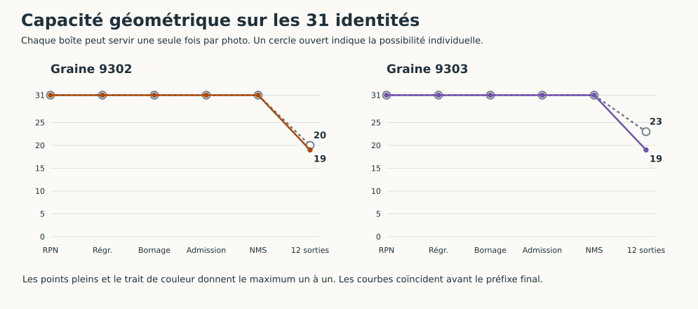
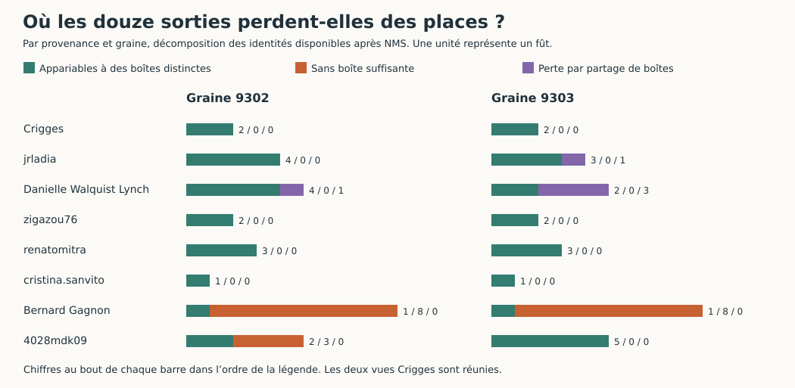

# Figures R29

Le premier graphique suit la borne géométrique par graine et par étage. Le second répartit les places perdues au préfixe final entre absence de boîte suffisante et concurrence. [Valeurs numériques des deux figures](donnees.json) · [Effectifs par provenance](../provenances.md)

