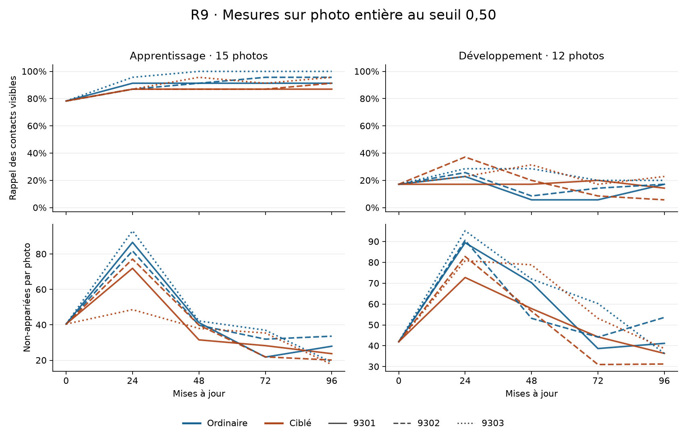
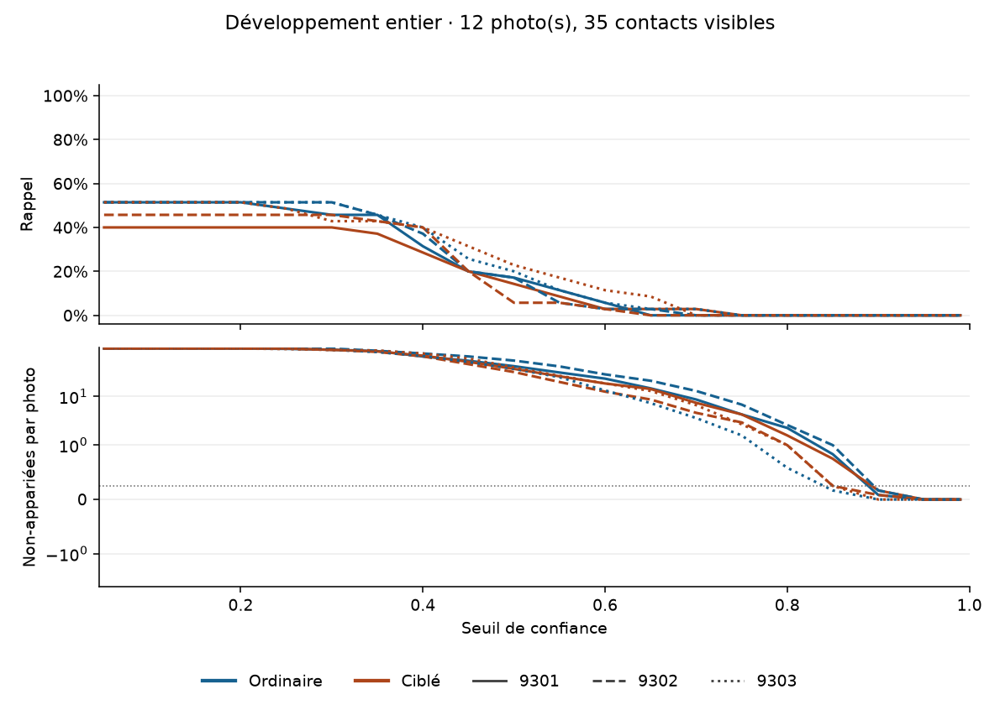

# Lire les courbes R9

Les six courbes de chaque graphique correspondent aux deux bras (couleur) et aux trois graines (style du trait). Les images sont les tracés statistiques du lancement validé. Elles portent sur des photos entières d’apprentissage ou de développement.

## Apprentissage au seuil descriptif de 0,50

Les abscisses sont les mises à jour. Dans la [synthèse numérique](../mesures.json), prendre `runs[essai].learning`, puis `train050` ou `dev050`. Le panneau supérieur montre `matched / known` et le panneau inférieur `unmatched / photos`.

## Développement au pas 96

L’axe horizontal donne le seuil. Le panneau inférieur utilise une échelle linéaire près de zéro puis logarithmique. La ligne pointillée représente le budget de 0,25 pour le lot entier. Sur un graphique de provenance, elle sert de repère. Chaque provenance compte ici une seule photo. Quand aucun contact visible n’est annoté, le rappel est indéfini.

| Provenance | Graphique | Provenance | Graphique |
|---|---|---|---|
| April L. Sanders | [01.png](01.png) | Framsókn | [02.png](02.png) |
| Iain Cuthbertson | [03.png](03.png) | Ivan Radic | [04.png](04.png) |
| Staff Sgt. Brent Powell | [05.png](05.png) | TheNickster | [06.png](06.png) |
| TimWilson | [07.png](07.png) | Wesley Fryer | [08.png](08.png) |
| cobaltfish | [09.png](09.png) | gothick_matt | [10.png](10.png) |
| russellstreet | [11.png](11.png) | vastateparksstaff | [12.png](12.png) |

## Données des six essais

| Graine | Tirage ordinaire | Tirage ciblé |
|---|---|---|
| 9301 | [Relevé ordinaire](../train/ordinary-9301.json) | [Relevé ciblé](../train/targeted-9301.json) |
| 9302 | [Relevé ordinaire](../train/ordinary-9302.json) | [Relevé ciblé](../train/targeted-9302.json) |
| 9303 | [Relevé ordinaire](../train/ordinary-9303.json) | [Relevé ciblé](../train/targeted-9303.json) |

Dans chaque relevé, `reports.dev.curve` contient un enregistrement par seuil `t`. Les PNG utilisent les 21 seuils de 0,05 à 0,99. Le point 2,0, disponible en JSON, correspond à l’abstention totale. Prendre `all` pour le lot entier et `per_group[nom]` pour une provenance. Les fichiers donnent aussi `grouped` pour les groupes serrés et `worn` pour les supports usés. Ces strates peuvent se recouvrir. Les dénominateurs et les conditions de chaque photo figurent dans le [registre des partitions](../sources.json).

| Champ | Lecture |
|---|---|
| `known`, `matched` | Contacts visibles de référence et contacts retrouvés par appariement un à un |
| `photos`, `proposals` | Photos évaluées et propositions émises |
| `unmatched`, `false`, `unresolved` | Toutes les non-appariées, puis les deux termes de leur somme, faux établis et cas non résolus |
| `silent`, `empty_with_points` | Photos sans proposition et témoins vides ayant déclenché au moins une fois |
| `reports.dev.locked`, `reports.dev.at050` | Résultats finaux au seuil de décision et à 0,50, avec détail par photo. La même structure existe sous `reports.train`. |
| `curve`, `losses` à la racine | Mesures sur photos entières aux cinq pas du suivi et pertes des 96 mises à jour |

La sélection a utilisé les scores distincts observés. Les seuils admissibles, le premier dépassement du budget et le premier vrai contact sont publiés pour chaque essai. [Vérification du seuil de décision](../selection.json) · [Règle préenregistrée](../protocole.md) · [Reproduire les graphiques](../reproduire.md)
